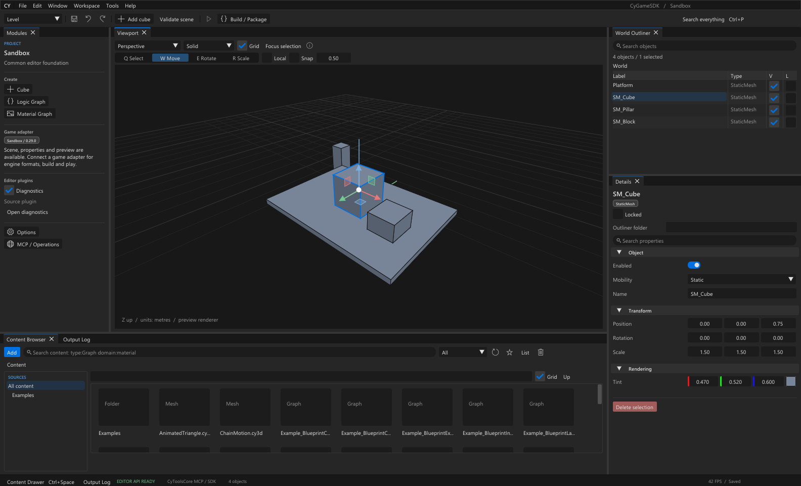
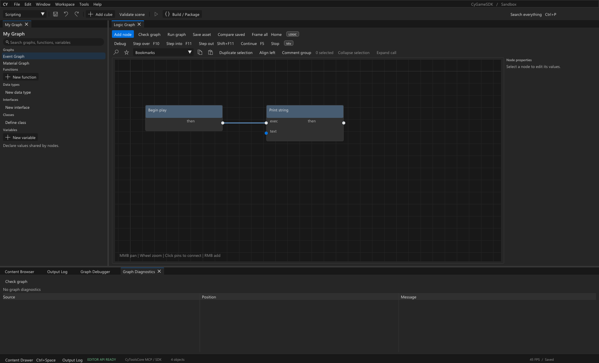
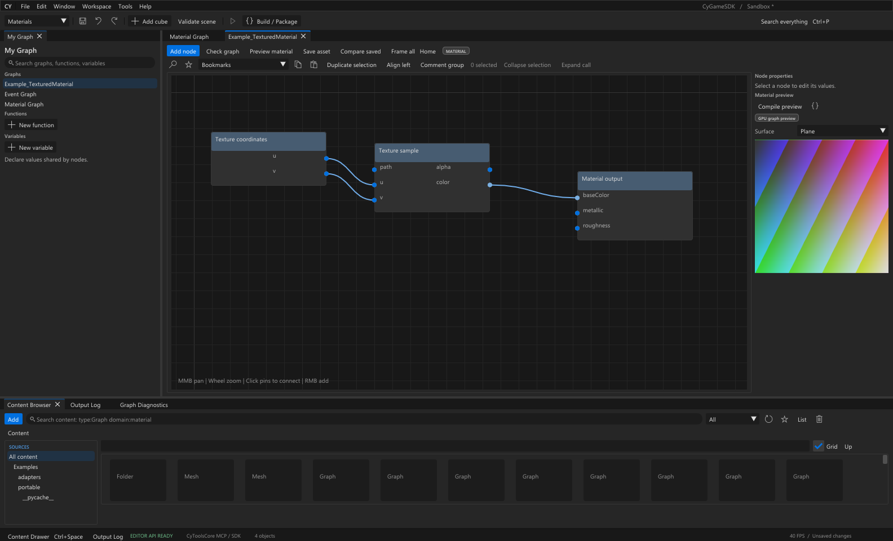
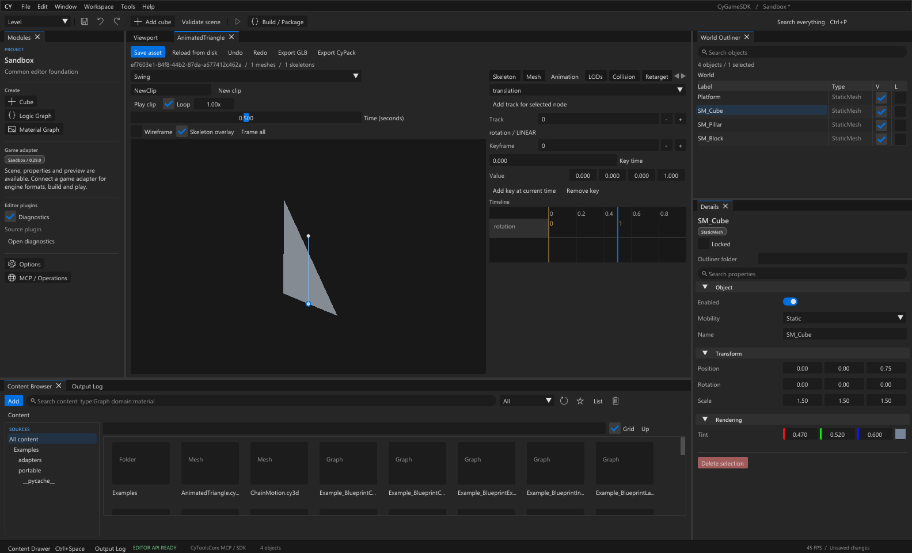

<table width="100%">
  <tr>
    <td width="300" align="left" valign="top">
      <a href="https://mrmybal.github.io/CyGameSDK/?lang=fr">Présentation</a><br>
      <a href="https://mrmybal.github.io/CyGameSDK/manual/Documentation.html#/fr/overview">Manuel</a><br>
      <a href="https://github.com/MrMybal/CyGameSDK">GitHub</a><br><br>
      <sub>README</sub><br>
      <a href="README.md">English</a> · <a href="README.fr.md">Français</a>
    </td>
    <td width="400" align="center" valign="middle">
      <a href="https://mrmybal.github.io/CyGameSDK/?lang=fr"></a>
    </td>
    <td width="300" align="right" valign="top">
      <p><sub>Licence de l’application</sub><br><a href="LICENSE"><strong>MIT</strong></a></p>
      <p><sub>Éditeur / catalogue</sub><br><a href="app/Docs/Release-0.29.0.fr.md"><strong>0.29.0</strong></a><br><strong>PRÉVERSION DE DÉVELOPPEMENT</strong></p>
      <p><a href="https://github.com/MrMybal/CyGameSDK/releases/download/v0.29.0/CyGameSDK-0.29.0-source.zip"><strong>Télécharger les sources</strong></a><br><sub>Archive de sources · compilation Windows x64</sub></p>
    </td>
  </tr>
</table>

<h1 align="center">CyGameSDK</h1>

Une base d’éditeur natif réutilisable pour les développeurs qui créent un SDK ou
un outil d’édition propre à un jeu. Partez d’un espace de travail ancrable, de
graphes visuels, d’éditeurs de ressources et d’un SDK MCP/IA commun, puis reliez
les formats, le rendu et la chaîne d’outils du jeu choisi.

> **PRÉVERSION DE DÉVELOPPEMENT · 0.29.0**
>
> Outils expérimentaux avec un adaptateur Sandbox. Les fonctionnalités suivent des
> limites documentées ; la compatibilité d’un jeu nécessite un adaptateur vérifié.
> Consultez les [notes de version, le contenu du téléchargement et les limites connues](app/Docs/Release-0.29.0.fr.md).

[](app/Docs/images/editor-workspace.png)

## À propos de CyGameSDK

Organisez les panneaux, sélectionnez les objets de scène, modifiez les propriétés
décrites par leurs schémas et annulez les changements de documents. Parcourez les
ressources et ouvrez leur éditeur spécialisé : graphe, matériau, JSON ou 3D neutre.
L’interface inspirée d’Unreal utilise C++17, l’ancrage Dear ImGui, les modules CyUI
et Direct3D 11. L’anglais est la langue par défaut et de repli ; le français se
sélectionne dans Options et un choix enregistré explicitement est conservé.

### Logique visuelle et matériaux

Créez des graphes logiques typés avec fonctions locales, macros, classes et interfaces.
Inspectez l’exécution avec points d’arrêt et pile d’appels. Prévisualisez les
changements de signatures/types avant application, réduisez des sélections pures
prises en charge en fonctions ou développez leurs appels en nœuds éditables, avec Undo.

[](app/Docs/images/logic-graph.png)

Créez des graphes de matériaux, de l’échantillonnage de textures et des instances,
puis compilez l’aperçu DX11 par un worker CyToolsCore. Ce workflow produit un shader
d’éditeur ; le format et le compilateur de matériaux d’un jeu demandent leur propre fournisseur.

[](app/Docs/images/material-editor.png)

### Ressources, animation et automatisation

Travaillez avec les documents `.cy3d` bornés de maillages, squelettes et animations.
Échangez des ressources GLB et CyPack, créez LOD statiques et formes de collision,
puis utilisez le reciblage par pose de référence, l’IK hors ligne, les paires de
mouvement racine et le découpage/rééchantillonnage des clips. Ces profils d’édition
sont documentés ; ils ne constituent ni un logiciel DCC complet ni une prise en
charge automatique des fichiers d’un jeu.

[](app/Docs/images/animation-editor.png)

CyToolsCore fournit MCP, le SDK IA, l’authentification, les jobs et ProcessWorker.
L’interface, l’IPC natif et le SDK partagent la validation d’EditorCore et les
transactions de documents. Les adaptateurs source apportent décodage, écriture,
rendu et compilation/lancement propres au jeu. Le registre de codecs est vide par
défaut ; la compatibilité complète Unreal Engine/Blueprint n’est pas fournie.

## Fonctionnalités

- **Espace de travail** : onglets ancrés, fenêtres détachées, dispositions enregistrées,
  caméras indépendantes, recherche de commandes, thèmes, taille du texte et gestion du DPI.
- **Ressources** : dossiers, filtres, miniatures, favoris, références, import/réimport
  protégé, édition JSON en arbre et inspection bornée des PNG/JPEG/BMP.
- **Graphes** : énumérations/structures nominales, conteneurs, fonctions, macros,
  interfaces, débogueur, migrations contrôlées et réduction/développement d’appels purs.
- **Matériaux et 3D** : aperçus d’éditeur compilés, édition de maillages/squelettes/animations
  neutres, échanges portables, LOD, formes de collision et outils de mouvement.
- **Automatisation** : 175 opérations d’éditeur, 196 outils avec les contrôles Core,
  schémas communs et progression/annulation explicites des jobs.
- **Aide locale** : lecteur CyDoc avec 35 chapitres anglais/français et la référence
  des opérations ; Help et F1 contextuel ouvrent la bonne page, sans serveur.

---

## Installation

Le téléchargement publié **v0.29.0 contient les sources**, pas un installeur ni un
éditeur précompilé. L’hôte graphique natif fonctionne sous Windows x64 / Direct3D 11.
Les hôtes natifs Linux/macOS ne sont pas implémentés.

1. [Téléchargez l’archive de sources v0.29.0](https://github.com/MrMybal/CyGameSDK/releases/download/v0.29.0/CyGameSDK-0.29.0-source.zip)
   et extrayez-la dans un nouveau dossier, ou clonez les sources actuelles ci-dessous.
2. Suivez les prérequis et commandes de compilation de la source choisie.
3. Lancez `CyGameEditor.exe` compilé ou `Lancer.cmd`. L’hôte graphique nécessite
   le runtime Microsoft Visual C++ 2015–2022 x64.

**La branche `main` actuelle inclut l’aide CyDoc ; l’archive v0.29.0 publiée est
antérieure à cette intégration.** Clonez `main` pour disposer du manuel complet
actuel et de l’aide F1. Les étapes propres à l’archive restent dans son
[guide de version d’origine](https://github.com/MrMybal/CyGameSDK/blob/v0.29.0/app/Docs/Release-0.29.0.md).

Au premier lancement, la scène est une démonstration Sandbox. Ctrl+S sauvegarde
le projet ; Ctrl+O le recharge. Projets, ressources de travail et préférences se
trouvent dans `data/projects`, `data/assets` et `data/settings` de cette installation.
Conservez des sauvegardes des données existantes. L’installation des exemples
fournis n’écrase jamais les ressources déjà présentes.

Le manuel actuel s’ouvre aussi directement avec
[`Documentation/Documentation.html`](Documentation/Documentation.html#/fr/overview),
accompagné de son dossier `DocData/` complet. La lecture ne nécessite ni Node.js ni Internet.

## Sources, compilation et bibliothèques nécessaires

<details>
<summary>Compiler les sources actuelles et configurer MCP / les jobs des workers</summary>

### Prérequis

- Windows x64 ; Visual Studio 2022 avec **Développement Desktop en C++** et SDK Windows.
- Git et CMake 3.24+ ; les outils CMake de Visual Studio sont détectés automatiquement.
- Node.js 22+ et npm pour générer le manuel CyDoc actuel, pas pour le lire.
- Les [révisions exactes de CyUI et CyDoc](app/dependencies.lock.json), récupérées
  depuis leurs dépôts source. Une compilation hors ligne nécessite les dépendances
  et chaînes d’outils entièrement en cache, pas seulement un dossier de sources.
- Pour MCP, le SDK IA, les imports et les jobs de shaders/compilation : Python 3.11+ et
  la **wheel CyToolsCore 0.10.1**, construite au préalable depuis le dépôt Core.

### Récupérer les sources

```sh
git clone https://github.com/MrMybal/CyGameSDK.git
cd CyGameSDK
```

### Compiler et lancer

Exécutez PowerShell depuis la racine du dépôt :

```powershell
.\app\build.ps1
.\Lancer.cmd
```

Pour MCP et les jobs des workers, préparez la wheel
`CyToolsCore/dist/cytools_core-0.10.1-py3-none-any.whl`, puis configurez l’environnement
Python privé. Le dépôt Core par défaut se trouve à côté de CyGameSDK :

```powershell
.\app\setup_mcp.ps1
.\runtime\python\Scripts\python.exe app\setup_examples.py
```

Sélectionnez d’autres checkouts autorisés avec `-CyUIRoot` sur `app/build.ps1`
ou `-CyToolsCoreRoot` sur `app/setup_mcp.ps1`. Le checkout CyUI fourni doit être propre
et correspondre exactement au verrou ; il n’est pas modifié. `-BuildDirectory` et
`-OutputDirectory` sélectionnent une compilation native indépendante.

CyUI partage une seule instance ImGui appartenant à l’hôte et compile les modules
sélectionnés. Les intégrations natives Audio, Gallery, Demo, CodeEditor et Web/CEF
sont désactivées. Le lecteur CyDoc distinct utilise image, gallery et graph, sans Three.js.

Le build place `CyGameEditor.exe` à la racine du projet et copie le manuel local
complet à côté. `app/build_native.cmd` utilise la même entrée CMake.
Pour régénérer uniquement le manuel :

```powershell
powershell -NoProfile -ExecutionPolicy Bypass -File app/build_documentation.ps1
```

### Connecter un client MCP

Démarrez l’éditeur et adaptez les chemins d’installation dans
[app/mcp.example.json](app/mcp.example.json). Avec le Python privé, exécutez :

```powershell
.\runtime\python\Scripts\python.exe app\tool.py describe
.\runtime\python\Scripts\python.exe app\tool.py mcp
```

Découvrez les opérations avec `cy_list_operations` / `cy_describe_operation`, appelez
`op_<id>` et suivez `cy_get_job` jusqu’à Completed, Cancelled ou Failed. Après un
timeout de modification, inspectez l’état réel avant de réessayer. Les clients
partagés utilisent le service HTTP authentifié et le pont MCP existants de Core.

Détails : [résolution des problèmes](app/Docs/LaunchRecovery.md),
[intégration CyUI](app/Docs/CyUIMigration.md),
[génération CyDoc](app/Docs/CyDocIntegration.md).

</details>

---

## Licence

**Le code, la documentation et les exemples originaux de CyGameSDK sont sous [licence MIT](LICENSE).**
Conservez ses mentions de copyright et sa licence lors d’une redistribution.
Les bibliothèques tierces gardent leurs propres conditions.

### Éditeur natif et SDK

| Bibliothèque · sources | Licence · texte | Utilisation / périmètre |
| --- | --- | --- |
| [CyUI 1.2.0](https://github.com/MrMybal/CyUI) | [MIT et notices des composants](app/LICENCES/CyUI-MIT.txt) · [notices intégrées](app/LICENCES/CyUI-THIRD-PARTY-NOTICES.md) | Modules natifs sélectionnés ; révision exacte dans le verrou des dépendances. |
| [Dear ImGui, version CyUI verrouillée](https://github.com/ocornut/imgui) | [MIT](app/LICENCES/Dear-ImGui-MIT.txt) | Ancrage et rendu des widgets natifs ; une instance commune. |
| [stb intégré](https://github.com/nothings/stb) | [Option MIT](app/LICENCES/Dear-ImGui-stb-MIT.txt) | Utilitaires de polices/texte fournis avec ImGui. |
| [ImGuizmo](https://github.com/CedricGuillemet/ImGuizmo) | [MIT](app/LICENCES/ImGuizmo-MIT.txt) | Gizmos de transformation du viewport ; sources verrouillées. |
| [nlohmann/json 3.11.3](https://github.com/nlohmann/json) | [MIT](app/LICENCES/nlohmann-json-MIT.txt) | JSON des documents et opérations natifs. |
| [Lexilla, Scintilla et données SciTE](https://github.com/ScintillaOrg/lexilla) | [Notice permissive](app/LICENCES/Lexilla.txt) · [Scintilla](app/LICENCES/Scintilla.txt) · [SciTE](app/LICENCES/SciTE-Properties.txt) | Moteurs syntaxiques, en-têtes d’interface et propriétés via Code/Diff ; aucune interface d’éditeur Scintilla. |
| [CyToolsCore 0.10.1](https://github.com/MrMybal/CyToolsCore) | [MIT](app/LICENCES/CyToolsCore-MIT.txt) | SDK MCP/IA Python, sessions authentifiées, jobs et workers. |
| [CPython et paquets Python](https://github.com/python/cpython) | [Conditions Python](app/LICENCES/Python.txt) · [licences/notices des paquets](app/licenses-python.json) | Environnement MCP/workers configuré séparément ; chaque paquet conserve sa licence. |
| Microsoft Windows SDK / Direct3D / runtime C++ | [Périmètre des composants](app/LICENCES/README.md) · conditions Microsoft | Hôte Windows et chaîne graphique ; les polices système ne sont pas redistribuées. |

### Documentation et outils de compilation

| Bibliothèque · sources | Licence · texte | Utilisation / périmètre |
| --- | --- | --- |
| [CyDoc 0.1.0](https://github.com/MrMybal/CyDoc) | [MIT](app/LICENCES/CyDoc-MIT.txt) | Lecteur local exporté ; modules image, gallery et graph. |
| [Node.js 22+](https://github.com/nodejs/node) | [MIT et notices des composants](https://github.com/nodejs/node/blob/main/LICENSE) | Génération de la documentation ; inutile au lecteur. |
| [marked 17.0.6](https://github.com/markedjs/marked) | [MIT](https://github.com/markedjs/marked/blob/v17.0.6/LICENSE.md) | Compilation Markdown dans la chaîne d’outils verrouillée de l’application. |
| [PrismJS 1.30.0](https://github.com/PrismJS/prism) | [MIT](https://github.com/PrismJS/prism/blob/v1.30.0/LICENSE) | Coloration du code lors de la génération. |
| [esbuild 0.25.12](https://github.com/evanw/esbuild) | [MIT](https://github.com/evanw/esbuild/blob/v0.25.12/LICENSE.md) | Assemblage du lecteur hors ligne et des modules sélectionnés. |
| [TypeScript](https://github.com/microsoft/TypeScript) | [Apache-2.0](https://github.com/microsoft/TypeScript/blob/main/LICENSE.txt) | Compilation du paquet CyDoc verrouillé avant export. |

Ce tableau sert d’index et ne remplace pas les notices complètes. Conservez
[app/LICENCES](app/LICENCES/README.md), les notices des paquets Python et les fichiers
de licence livrés avec la documentation générée et les paquets d’outils.

## Références et liens

- [Manuel français](https://mrmybal.github.io/CyGameSDK/manual/Documentation.html#/fr/overview) · [English manual](https://mrmybal.github.io/CyGameSDK/manual/Documentation.html#/en/overview).
- [Présentation](https://mrmybal.github.io/CyGameSDK/?lang=fr) · [Dépôt des sources](https://github.com/MrMybal/CyGameSDK).
- [Version source publiée](https://github.com/MrMybal/CyGameSDK/releases/tag/v0.29.0) · [Suivi des problèmes](https://github.com/MrMybal/CyGameSDK/issues).
- [Contrat des ressources portables](https://mrmybal.github.io/CyGameSDK/manual/Documentation.html#/fr/portable-assets) · [Exemple d’adaptateur source](app/examples/adapters/ExampleGameAdapter.h).

<details>
<summary><strong>AI Usage</strong></summary>

- [Commencer ici : guide IA principal](AI_GUIDE.md) — présentation du projet, fichiers importants et création d’un SDK pour un jeu.
- [Instructions du dépôt](AGENTS.md) · [Guide de développement natif](app/AGENTS.md) — responsabilités, versions et contraintes d’implémentation.
- [Compiler cette application](app/Docs/LaunchRecovery.md) — configuration et résolution des problèmes de lancement.
- [Créer un adaptateur de jeu](app/Docs/GameAdapterGuide.md) · [Dossier de portage](app/Docs/GamePortingTemplate.md) — contrats source et éléments de preuve propres au jeu.
- [Intégration CyUI](app/Docs/CyUIMigration.md) · [Rédaction/compilation CyDoc](app/Docs/CyDocIntegration.md) — modules d’interface et maintenance de l’aide locale.

</details>
