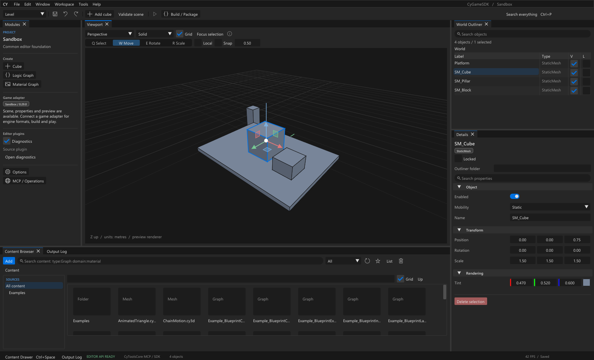
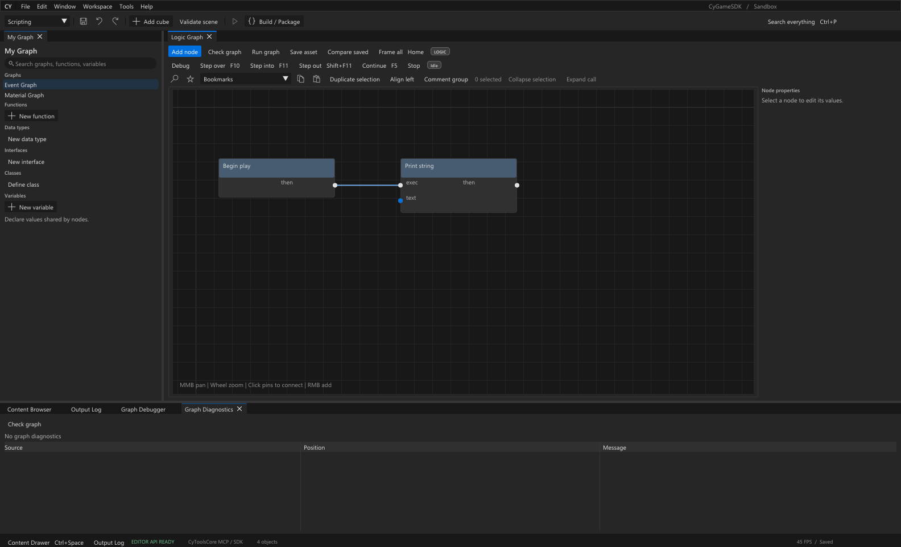
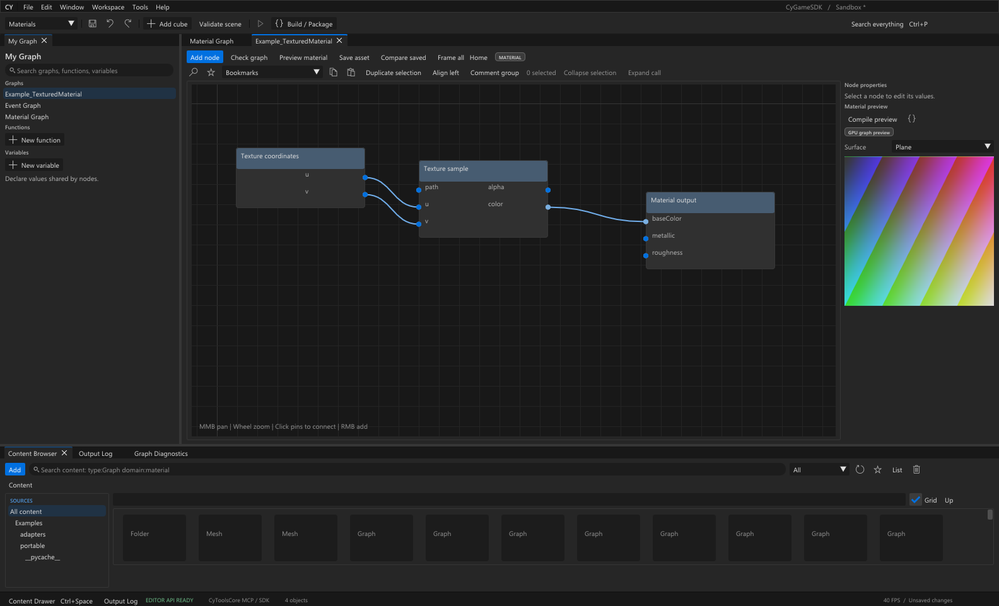
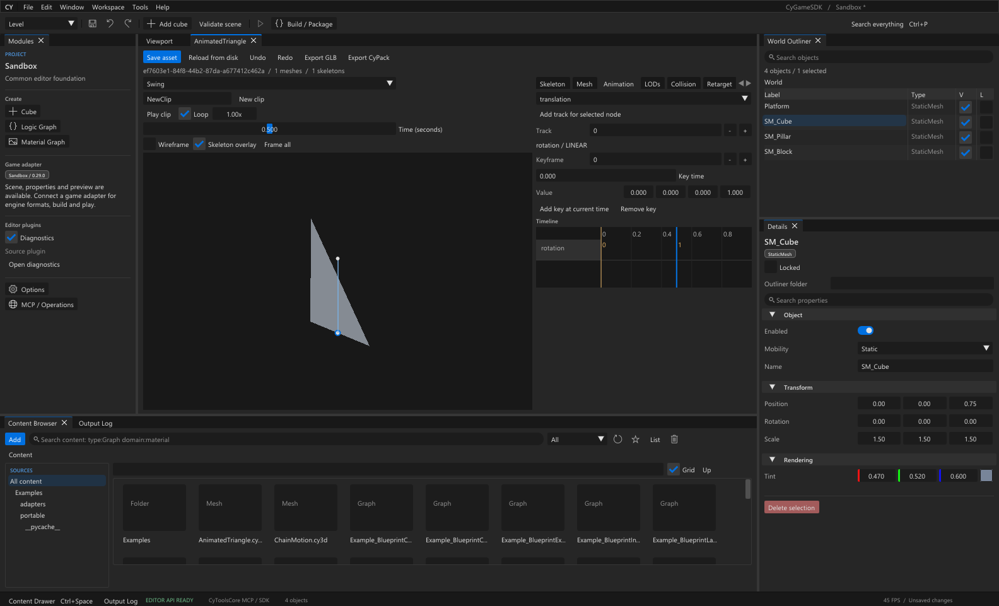
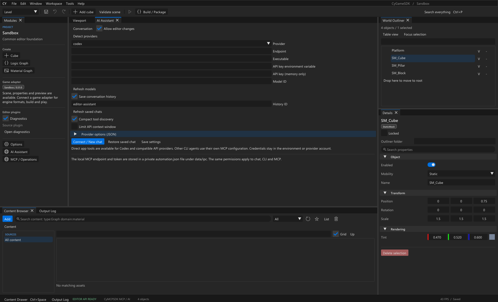

<table width="100%">
  <tr>
    <td width="300" align="left" valign="top">
      <a href="https://mrmybal.github.io/CyGameSDK/">Website</a><br>
      <a href="https://mrmybal.github.io/CyGameSDK/manual/Documentation.html#/en/overview">Manual</a><br>
      <a href="https://github.com/MrMybal/CyGameSDK">GitHub</a><br><br>
      <sub>README</sub><br>
      <a href="README.md">English</a> · <a href="README.fr.md">Français</a>
    </td>
    <td width="400" align="center" valign="middle">
      <a href="https://mrmybal.github.io/CyGameSDK/"></a>
    </td>
    <td width="300" align="right" valign="top">
      <p><sub>Application license</sub><br><a href="LICENSE"><strong>MIT</strong></a></p>
      <p><sub>Editor / catalogue</sub><br><a href="app/Docs/Release-0.32.0.md"><strong>0.32.0</strong></a><br><strong>DEVELOPMENT PREVIEW</strong></p>
      <p><a href="https://github.com/MrMybal/CyGameSDK/releases/download/v0.32.0/CyGameSDK-0.32.0-windows-x64.zip"><strong>Download Windows x64</strong></a><br><a href="https://github.com/MrMybal/CyGameSDK/releases/download/v0.32.0/CyGameSDK-0.32.0-source.zip">Source ZIP · v0.32.0</a></p>
    </td>
  </tr>
</table>

<h1 align="center">CyGameSDK</h1>

A reusable native editor foundation for developers building a game-specific SDK
or authoring tool. Start with a dockable workspace, visual graphs, asset editors
and a shared MCP/AI SDK, then connect the formats, renderer and toolchain of the
game you want to support.

> **DEVELOPMENT PREVIEW · 0.32.0**
>
> CyMCPSDK 0.7.1 · Free access by default · Windows x64 preview.
>
> Experimental tooling with a Sandbox adapter. Features follow documented limits;
> game compatibility requires a verified adapter. Read the
> [version notes, download scope and known limitations](app/Docs/Release-0.32.0.md).

[](app/Docs/images/editor-workspace.png)

## About CyGameSDK

Arrange panels, select scene objects, edit schema-driven properties and undo document
changes. Browse assets and open a specialized graph, material, JSON or neutral 3D
editor. The Unreal-inspired workspace uses C++17, Dear ImGui docking, modular CyUI
and Direct3D 11. English is the default and fallback language; French is selectable
in Options and an explicitly saved choice is preserved.

### Visual logic and materials

Create typed logic graphs with local functions, macros, classes and interfaces.
Inspect execution with breakpoints and a call stack. Preview signature/type changes
before applying them, collapse supported pure selections into helpers, or expand
pure calls into editable nodes with document Undo.

[](app/Docs/images/logic-graph.png)

Author material graphs, texture sampling and instances, then compile the DX11
editor preview through an SDK-owned compute worker. This is an editor shader workflow;
a game's material format and compiler need their own provider.

[](app/Docs/images/material-editor.png)

### Assets, animation and automation

Work with bounded `.cy3d` mesh, skeleton and animation documents; exchange GLB and
CyPack assets, author static LODs/collision shapes and use reference-pose retargeting,
offline IK, root-motion pairs and clip trim/resample tools. These are documented
editing profiles, not a complete DCC application or automatic support for game files.

[](app/Docs/images/animation-editor.png)

CyMCPSDK supplies the integrated assistant, shared operation registry, CLI and MCP. The
interface, native IPC and SDK share EditorCore validation and document transactions.
Source adapters supply real game decoding, serialization, rendering and build/play
behavior. The default codec registry is empty; full Unreal Engine/Blueprint
compatibility is not provided.

### Integrated assistant

Choose a provider/model, stream replies, attach files and restore private conversations.
The selected access profile controls operation access; the assistant, CLI and MCP share validation
and document Undo. Durable job results remain recoverable after restart.

[](app/Docs/images/assistant-settings.png)

## Features

- **Editor UI:** typed collections and numeric expressions,
  common scene hierarchy/property table, native source picker, configurable
  shortcuts, shared JSON editing and comment-group gestures with one Undo.

- **Workspace:** docked tabs, detached windows, saved layouts, independent viewport
  cameras, command search, themes, text size and DPI support.
- **Assets:** folders, filters, thumbnails, favorites, references, guarded
  import/reimport, JSON tree editing and bounded PNG/JPEG/BMP inspection.
- **Graph authoring:** nominal enum/record types, containers, functions, macros,
  interfaces, debugger, guarded migrations and pure-call collapse/expansion.
- **Materials and 3D:** compiled editor previews, neutral mesh/skeleton/animation
  editing, portable interchange, LODs, collision shapes and motion tools.
- **Automation:** 177 business operations through the integrated assistant, native CLI
  and MCP, with one registry, explicit permissions and durable/cancellable jobs.
- **Local help:** a CyDoc reader with 35 English/French chapters and the operation
  reference; Help and contextual F1 open the relevant page. No server is needed.

---

## Installation

Version **0.32.0** is a Windows x64 / Direct3D 11 development preview.

1. [Download the Windows ZIP](https://github.com/MrMybal/CyGameSDK/releases/download/v0.32.0/CyGameSDK-0.32.0-windows-x64.zip)
   and extract it into a new writable folder. It contains the editor, native CLI,
   application sources/examples, notices and the complete bilingual offline manual.
2. Install the Microsoft Visual C++ 2015–2022 x64 runtime if it is missing.
3. Start **CyGameEditor.exe** or **Lancer.cmd**. Native scene editing, assistant and
   CLI/MCP do not require Python, Node.js, Visual Studio or a dependency checkout.
4. For imports, preview shader compilation, packaging and 3D compute jobs, install
   Python 3.11+ and run **app/setup_mcp.ps1** from PowerShell. Install optional example
   assets with **runtime/python/Scripts/python.exe app/setup_examples.py**.

This ZIP is a portable folder distribution, not an installer. It does not include
Python, model weights or credentials. Configure your own provider/account in AI Assistant.
Linux/macOS native hosts are not implemented.

[Source ZIP](https://github.com/MrMybal/CyGameSDK/releases/download/v0.32.0/CyGameSDK-0.32.0-source.zip) ·
[Offline manual ZIP](https://github.com/MrMybal/CyGameSDK/releases/download/v0.32.0/CyGameSDK-0.32.0-documentation.zip) ·
[SHA-256 checksums](https://github.com/MrMybal/CyGameSDK/releases/download/v0.32.0/SHA256SUMS.txt)

To build from source, follow the requirements below. Git access to private dependencies
may be required; the prebuilt native tools do not need those repositories.
The bundled manual matches 0.32.0. The online Pages manual follows its last deployment.

On first launch, the scene is a Sandbox demonstration. Ctrl+S saves the project;
Ctrl+O reloads it. Projects, working assets and preferences live in this installation's
`data/projects`, `data/assets` and `data/settings`. Keep existing data backed up.
Installing the supplied examples never overwrites existing assets.

The current manual can also be read directly from
[`Documentation/Documentation.html`](Documentation/Documentation.html), with its
complete `DocData/` folder beside it. Reading requires no Node.js or Internet access.

## Source, build and required libraries

<details>
<summary>Build the current source and configure MCP / worker jobs</summary>

### Requirements

- Windows x64; Visual Studio 2022 with **Desktop development with C++** and Windows SDK.
- Git and CMake 3.24+; the Visual Studio CMake tools are detected automatically.
- Node.js 22+ and npm for generating the current CyDoc manual, not for reading it.
- The exact [CyUI, CyMCPSDK and CyDoc revisions](app/dependencies.lock.json). The build obtains
  them from their source repositories. Offline builds need complete cached toolchains
  and dependencies, not just a source folder.
- CyMCPSDK 0.7.1 is compiled from its locked local C++ sources. Python 3.11+ is
  needed only for import, shader, packaging and 3D compute workers.

### Get the source

```sh
git clone https://github.com/MrMybal/CyGameSDK.git
cd CyGameSDK
```

### Build and run

Run PowerShell from the repository root:

```powershell
.\app\build.ps1
.\Lancer.cmd
```

For compute jobs, configure the private Python environment. Scene automation and
chat use the native SDK without a Python MCP server:

```powershell
.\app\setup_mcp.ps1
.\runtime\python\Scripts\python.exe app\setup_examples.py
```

Select clean locked checkouts with `-CyUIRoot` and `-CyMCPSDKRoot` on
`app/build.ps1`. `-BuildDirectory` and `-OutputDirectory` select independent builds.
Sibling libraries are read and built, without modification.

CyUI shares one host-owned ImGui instance and compiles the selected modules.
The optional CodeEditor backend uses a private C++20 bridge; the native host and
domain stay C++17. Audio, Gallery, demos, browser/CEF, Media and Office modules
are omitted.
CyDoc's separate reader uses image, gallery and graph; it does not ship Three.js.

The build writes `CyGameEditor.exe` and `CyGameCLI.exe` to the project root and copies the complete
local manual beside it. `app/build_native.cmd` delegates to the same CMake entry.
To regenerate only the manual:

```powershell
powershell -NoProfile -ExecutionPolicy Bypass -File app/build_documentation.ps1
```

### Assistant, CLI and MCP clients

Open **AI Assistant**, choose a configured provider and its actual model, then connect.
Free is the default: address-only MCP and all registered operations, without an extra
write grant. Local controlled, Token only and Protected remain selectable. Controlled
profiles retain **Allow editor changes**. Keys remain in memory/environment; history
is private and restorable. See [assistant/CLI/MCP integration](app/Docs/CyMCPSDKIntegration.md).

Start an editor for the selected project root and adapt [app/mcp.example.json](app/mcp.example.json):

~~~powershell
.\CyGameCLI.exe --help
.\CyGameCLI.exe describe-operation property_set
.\CyGameCLI.exe --root C:\Editors\MyGame invoke scene_list
.\CyGameCLI.exe --root C:\Editors\MyGame mcp
~~~

Compact MCP discovery exposes five tools; full discovery remains available with --full.
Existing app/tool.py commands and op_* job aliases remain. Job artifacts survive restarts
and transient-resource expiry. Never automatically replay a timed-out mutation.

Build/setup details: [troubleshooting](app/Docs/LaunchRecovery.md),
[CyUI integration](app/Docs/CyUIMigration.md),
[CyDoc generation](app/Docs/CyDocIntegration.md).

</details>

---

## License

**CyGameSDK's original code, documentation and examples use the [MIT license](LICENSE).**
Retain its copyright and license notice when redistributing. Third-party libraries
keep their own terms.

### Native editor and SDK

| Library · source | License · terms | Use / scope |
| --- | --- | --- |
| [CyUI 1.2.0](https://github.com/MrMybal/CyUI) | [MIT and component notices](app/LICENCES/CyUI-MIT.txt) · [bundled notices](app/LICENCES/CyUI-THIRD-PARTY-NOTICES.md) | Selected native UI modules; exact revision in the dependency lock. |
| [Dear ImGui, pinned CyUI snapshot](https://github.com/ocornut/imgui) | [MIT](app/LICENCES/Dear-ImGui-MIT.txt) | Docking and native widget rendering; one shared instance. |
| [Bundled stb](https://github.com/nothings/stb) | [MIT option](app/LICENCES/Dear-ImGui-stb-MIT.txt) | Font/text helpers included with ImGui. |
| [TextEditor](https://github.com/goossens/ImGuiColorTextEdit) | [MIT](app/LICENCES/TextEditor-MIT.txt) | Optional native text backend through the selected CyUI CodeEditor module. |
| [JetBrains Mono 2.304](https://github.com/JetBrains/JetBrainsMono) | [SIL OFL 1.1](app/LICENCES/JetBrains-Mono-OFL.txt) | Code font embedded through CyUI Core; no system installation. |
| [ImGuizmo](https://github.com/CedricGuillemet/ImGuizmo) | [MIT](app/LICENCES/ImGuizmo-MIT.txt) | Viewport transform gizmos; pinned source snapshot. |
| [nlohmann/json 3.11.3](https://github.com/nlohmann/json) | [MIT](app/LICENCES/nlohmann-json-MIT.txt) | Native document and operation JSON. |
| [Lexilla, Scintilla and SciTE data](https://github.com/ScintillaOrg/lexilla) | [Permissive notice](app/LICENCES/Lexilla.txt) · [Scintilla](app/LICENCES/Scintilla.txt) · [SciTE](app/LICENCES/SciTE-Properties.txt) | Syntax engines, interface headers and properties through Code/Diff; no Scintilla editor UI. |
| [CyMCPSDK 0.7.1](https://github.com/MrMybal/CyMCPSDK) | [MIT](app/LICENCES/CyMCPSDK-MIT.txt) | Native registry, CLI/MCP, providers and ChatUI; exact lock. |
| [MD4C](https://github.com/mity/md4c) | [MIT](app/LICENCES/MD4C-MIT.txt) | Markdown parsing through CyUI DocumentViews / ChatUI. |
| SDK dependencies | [Bundled notices](app/LICENCES/CyMCPSDK-THIRD-PARTY-NOTICES.md) · [nlohmann/json 3.12](app/LICENCES/CyMCPSDK-nlohmann-3.12-MIT.txt) · [cpp-httplib](app/LICENCES/cpp-httplib-MIT.txt) · [PicoSHA2](app/LICENCES/PicoSHA2-MIT.txt) | SDK JSON and transport/utility code; separate from host JSON. |
| [CPython and Python packages](https://github.com/python/cpython) | [Python terms](app/LICENCES/Python.txt) · [package licenses/notices](app/licenses-python.json) | Optional compute-worker environment; packages retain their listed licenses. |
| Microsoft Windows SDK / Direct3D / C++ runtime | [Component scope](app/LICENCES/README.md) · Microsoft terms | Windows host and graphics toolchain; system fonts are not redistributed. |

### Documentation and build tools

| Library · source | License · terms | Use / scope |
| --- | --- | --- |
| [CyDoc 0.1.0](https://github.com/MrMybal/CyDoc) | [MIT](app/LICENCES/CyDoc-MIT.txt) | Exported local reader; image, gallery and graph modules. |
| [Node.js 22+](https://github.com/nodejs/node) | [MIT and component notices](https://github.com/nodejs/node/blob/main/LICENSE) | Documentation generation toolchain; not a reader runtime. |
| [marked 17.0.6](https://github.com/markedjs/marked) | [MIT](https://github.com/markedjs/marked/blob/v17.0.6/LICENSE.md) | Build-time Markdown compilation in the locked application toolchain. |
| [PrismJS 1.30.0](https://github.com/PrismJS/prism) | [MIT](https://github.com/PrismJS/prism/blob/v1.30.0/LICENSE) | Build-time code highlighting. |
| [esbuild 0.25.12](https://github.com/evanw/esbuild) | [MIT](https://github.com/evanw/esbuild/blob/v0.25.12/LICENSE.md) | Bundling the offline reader and selected modules. |
| [TypeScript](https://github.com/microsoft/TypeScript) | [Apache-2.0](https://github.com/microsoft/TypeScript/blob/main/LICENSE.txt) | Building the pinned CyDoc package before export. |

This table is an index, not a replacement for complete notices. Preserve
[app/LICENCES](app/LICENCES/README.md), the Python package notices and the license
files distributed with generated documentation and toolchain packages.

## References and links

- [English manual](https://mrmybal.github.io/CyGameSDK/manual/Documentation.html#/en/overview) · [Manuel en français](https://mrmybal.github.io/CyGameSDK/manual/Documentation.html#/fr/overview).
- [Product website](https://mrmybal.github.io/CyGameSDK/) · [Source repository](https://github.com/MrMybal/CyGameSDK).
- [Windows/source release](https://github.com/MrMybal/CyGameSDK/releases/tag/v0.32.0) · [Issue tracker](https://github.com/MrMybal/CyGameSDK/issues).
- [Portable asset contract](https://mrmybal.github.io/CyGameSDK/manual/Documentation.html#/en/portable-assets) · [Source adapter example](app/examples/adapters/ExampleGameAdapter.h).

<details>
<summary><strong>AI Usage</strong></summary>

- [Start here: primary AI guide](AI_GUIDE.md) — project overview, important files and the path to a game-specific SDK.
- [Repository instructions](AGENTS.md) · [Native developer guide](app/AGENTS.md) — ownership, versions and implementation constraints.
- [Build this application](app/Docs/LaunchRecovery.md) — setup and launch troubleshooting.
- [Create a game adapter](app/Docs/GameAdapterGuide.md) · [Porting dossier](app/Docs/GamePortingTemplate.md) — source contracts and real game evidence.
- [CyUI integration](app/Docs/CyUIMigration.md) · [CyDoc authoring/build](app/Docs/CyDocIntegration.md) — presentation modules and local help maintenance.

</details>
