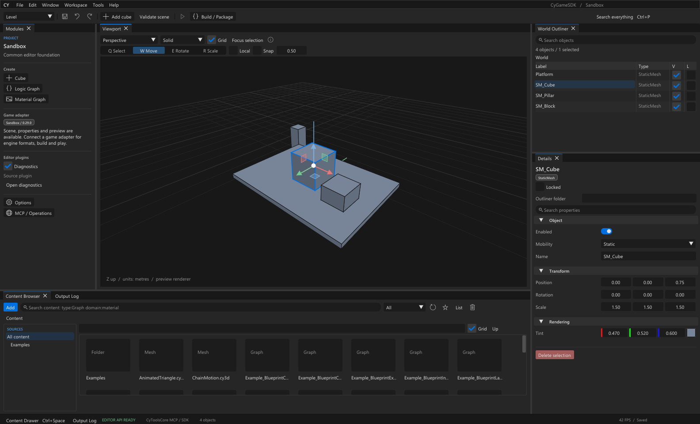
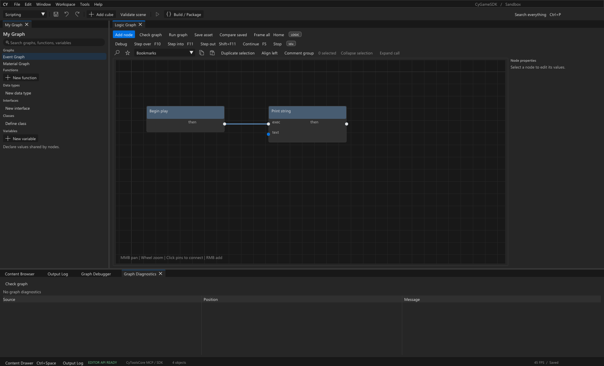
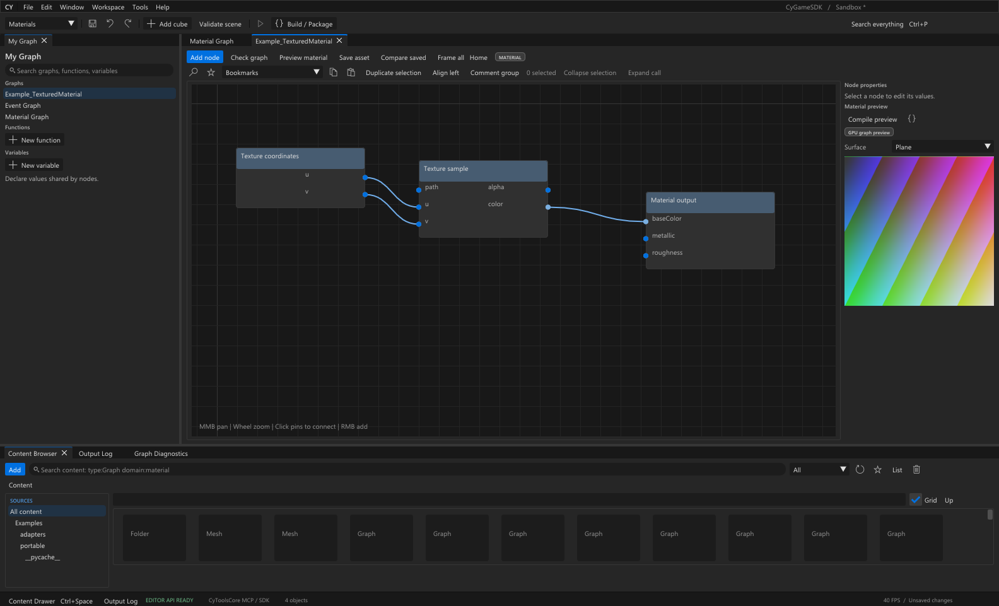
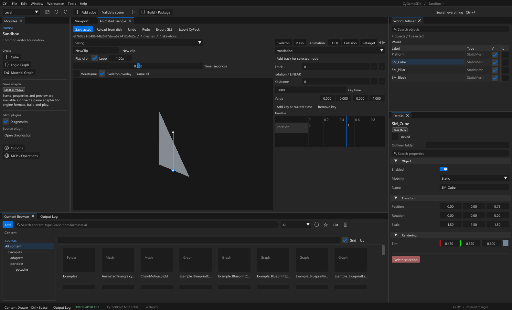

# CyGameSDK

CyGameSDK is a reusable native game editor foundation for building game-specific
SDKs and authoring tools. Its Unreal-inspired workspace uses C++17, Dear ImGui
docking, CyUI and Direct3D 11. CyToolsCore provides the existing MCP server, AI SDK,
authentication, jobs and ProcessWorker integration.

**Current source/catalogue version: 0.29.0.** The interface starts in English,
independently of the Windows locale. French is selectable in Options. An explicitly
saved language is preserved; English remains the source and fallback language.

This is a Windows development foundation with a Sandbox adapter. It does not
automatically support an arbitrary game engine, ship a real game codec, or provide
full Unreal Engine / Blueprint compatibility. A derived SDK needs verified game
formats, tools, runtime bindings and an adapter for the chosen game/version.

## Website and documentation

[Explore CyGameSDK](https://mrmybal.github.io/CyGameSDK/) ·
[Read the documentation](https://mrmybal.github.io/CyGameSDK/guide.html?lang=en) ·
[Download the source](https://github.com/MrMybal/CyGameSDK/releases/tag/v0.29.0)

The showcase and HTML setup guide are available in English and French.
[Présentation en français](https://mrmybal.github.io/CyGameSDK/?lang=fr) ·
[Documentation en français](https://mrmybal.github.io/CyGameSDK/guide.html?lang=fr).

## Screenshots

Captured from CyGameSDK 0.29.0 with the English interface and Sandbox examples.

**Editor workspace** — docked viewport, scene hierarchy, properties and Content Browser.



**Logic graph** — node connections, graph navigation and debugging controls.



**Material editor** — texture coordinates, sampling and a compiled DX11 preview.



**Animation editor** — skeleton overlay, clip controls, keyframes and timeline.



## Editor capabilities

- Docked tabs, detached windows, saved workspaces, multiple viewport cameras,
  global command search and schema-driven property editing.
- Scene hierarchy, selection, transform gizmos, snapping, grouping and document Undo.
  The Sandbox scene viewport is a demonstration renderer, not a game engine renderer.
- Asset browser with folders, search, field filters, thumbnails, references and
  protected import/reimport. Extension recognition alone is not a format decoder.
- Typed logic/material graphs, local functions/macros, classes, interfaces,
  containers, named enums/records, breakpoints and call-stack debugging.
- Explicit signature/type migration with preview and guarded apply. Collapse pure
  selections into helpers, or expand pure calls back into editable nodes. Default
  values, wire metadata and Undo are retained within the documented limits.
- Bounded neutral .cy3d mesh/skeleton/animation editing, DX11 mesh preview, GLB/CyPack
  import/export, static LODs, editable collision shapes, reference-pose retargeting,
  offline IK, root-motion extraction/reconstruction and clip trim/resample tools.
- JSON tree editing, bounded PNG/JPEG/BMP inspection, material instances and
  procedural graphs. Preview shaders compile through the official Core worker.
- Source extension seams for adapters, asset editors, graph nodes, viewport rendering
  and build/codec providers. The default game codec registry is empty.

See [Capability coverage](app/Docs/CapabilityCoverage.md),
[Editor architecture](app/Docs/EditorArchitecture.md) and
[Interface audit](app/Docs/InterfaceAudit.md) for implementation evidence and limits.
The current catalogue contains 175 editor operations / 196 tools including Core.

## Build from source

Requirements:

- Windows x64, Visual Studio 2022 with Desktop development with C++, and Windows SDK.
- Git and CMake 3.24+ (the Visual Studio CMake tools are detected automatically).
- Network access for the first pinned CyUI fetch, or a clean offline checkout at
  the revision in [app/dependencies.lock.json](app/dependencies.lock.json).
- For MCP, AI SDK and worker jobs: Python and the CyToolsCore 0.10.1 wheel built from
  your CyToolsCore checkout. MCP uses its pinned official Python transport.

CyUI 1.2.0 is fetched at the exact locked commit into `runtime/dependencies`.
The upstream repository is [MrMybal/CyUI](https://github.com/MrMybal/CyUI).
If repository access is restricted, authenticate Git with an account that has
access before building, or supply an authorized offline checkout using
`-CyUIRoot`. Do not put access tokens in CMake arguments or dependency URLs.
Its modular targets share one host-owned Dear ImGui instance. Audio, Gallery,
Demo, CodeEditor and Web/CEF are disabled. CyToolsCore remains a separate official
Python wheel; its setup script defaults to a sibling `CyToolsCore` checkout.
See [CyUI migration](app/Docs/CyUIMigration.md) for module selection and UI limits.

Run PowerShell from the repository root:

```powershell
.\app\build.ps1
.\app\setup_mcp.ps1
.\runtime\python\Scripts\python.exe app\setup_examples.py
.\Lancer.cmd
```

Custom dependency locations can be passed explicitly:

```powershell
.\app\build.ps1 -CyUIRoot 'C:\src\CyUI'
.\app\setup_mcp.ps1 -CyToolsCoreRoot 'C:\src\CyToolsCore'
```

`app/build.ps1` configures and builds [app/CMakeLists.txt](app/CMakeLists.txt).
`app/build_native.cmd` delegates to that same entry point; there is one source and
module list. `CyGameEditor.exe` is produced at the repository root. The native
contracts binary is written to `runtime/build/CyGameSDKTests.exe`.
Use `-BuildDirectory` and `-OutputDirectory` for an independent build. A supplied
CyUI checkout must be clean and match the lock exactly; it is never modified.

The graphical host needs the Microsoft C++ runtime. The private Python runtime
is used by MCP and worker operations. The current native host is Win32/DX11;
Linux/macOS hosts remain unimplemented. `CyGameEditor.sh` reports this limitation.

The Git repository contains source, documentation, dependency notices and generated
example fixtures. Executables, private runtimes, local reports/checkpoints, settings,
projects and working assets are kept locally and are not included. Historical
validation/checkpoint references in the guides refer to the local development
workspace; a fresh clone must build and run its own checks. The release identity
is recorded in [runtime/active-release.json](runtime/active-release.json).

Run the isolated native, SDK/MCP and graphical regression suites after building:

```powershell
.\runtime\python\Scripts\python.exe app\verify_cyui.py --captures
```

## First use

Open the built `CyGameEditor.exe` or `Lancer.cmd`. The startup scene is a Sandbox
demonstration. Ctrl+S saves the project; Ctrl+O reloads the saved project. User
projects live in `data/projects`, assets in `data/assets`, and preferences/layout
in `data/settings`. Example installation refuses to overwrite existing files.

- Content Browser → Examples3D: open StaticTriangle.cy3d or AnimatedTriangle.cy3d
  for Mesh / Skeleton / Animation, playback, keys and GLB/CyPack export.
- Examples3D/ChainMotion.cy3d → Motion tools: try IK baking, root-motion pairs or
  clip trim/resample. Source clips and reference poses are preserved.
- Examples/Example_TexturedMaterial.cyasset → Compile preview: compile the editor's
  DX11 material shader. This does not compile a game's material format.
- BlueprintExamples/Example_BlueprintExpand.cyasset: select Calculate, then
  **Expand call → Preview expansion → Apply expansion**. Run graph prints 9 before
  and after. Ctrl+Z / Ctrl+Y undo and redo. Execution-flow calls are not supported
  by this expansion operation; its definition remains available in My Graph.
- Window → Game Codecs: the provider list stays empty until trusted source code
  registers and verifies a real codec for a specific target.

The Sandbox build target packages document data into a ZIP through Core. It does
not cook game files or produce a runnable game. Game-specific build/play/render
behavior must be supplied and verified by the adapter.

## MCP and AI SDK

Start the editor, adapt the absolute placeholder paths in
[app/mcp.example.json](app/mcp.example.json), and configure your MCP client to start
`app/tool.py mcp` using the private Python environment. This uses CyToolsCore's
existing MCP server; the editor does not implement a second scheduler or server.

```powershell
.\runtime\python\Scripts\python.exe app\tool.py describe
.\runtime\python\Scripts\python.exe app\tool.py invoke scene_list
.\runtime\python\Scripts\python.exe app\tool.py mcp
```

The UI, native IPC and SDK operations use the same EditorCore and live document.
Discover operations through `cy_list_operations` / `cy_describe_operation`, call
`op_<id>`, and poll `cy_get_job` until Completed, Cancelled or Failed. A timed-out
mutation may already have applied: inspect the current state before retrying.
For several clients sharing one job runtime, use the existing authenticated Core
HTTP service and MCP bridge; see [MultiClient](app/Docs/MultiClient.md).

## Develop an editor for a game

Start with [AI_GUIDE.md](AI_GUIDE.md), then
[GameAdapterGuide](app/Docs/GameAdapterGuide.md). Copy
[GamePortingTemplate](app/Docs/GamePortingTemplate.md) into the derived SDK's docs
and fill in the game version, observed format details, tools, unknowns and validation
fixtures. Use a separate project; preserve installed game files and this foundation.
[ExampleGameAdapter.h](app/examples/adapters/ExampleGameAdapter.h) demonstrates the
source-level adapter seam, without a game parser or runtime binding.

For shared meshes, rigs and animation interchange, read
[CommonAssetFormat](app/Docs/CommonAssetFormat.md). CyPack v1 preserves GLB payloads,
package IDs and unknown metadata. Conversion profiles describe capabilities;
they do not implement a game's native codec.

Focused guides:

- [Native 3D assets](app/Docs/Native3DAssets.md), [advanced authoring](app/Docs/AdvancedAuthoring.md)
  and [animation tools](app/Docs/AnimationTools.md).
- [Named types](app/Docs/NamedGraphTypes.md), [interfaces](app/Docs/GraphInterfaces.md),
  [signature migration](app/Docs/SignatureMigration.md) and [type migration](app/Docs/TypeMigration.md).
- [Collapse selection](app/Docs/GraphCollapse.md) and [expand call](app/Docs/GraphExpand.md).
- [Material pipeline](app/Docs/MaterialPipeline.md), [build providers](app/Docs/BuildProviders.md)
  and [game codecs](app/Docs/GameCodecs.md).

## Verify a build

```powershell
.\runtime\build\CyGameSDKTests.exe (Get-Location).Path
$env:CYGAME_TEST_GUI='1'
.\runtime\python\Scripts\python.exe -m unittest discover -s app\tests -p 'test_*.py' -v
```

Tests use isolated workspaces under `data/reports`. Renderer captures can be made
with the `app/capture_*.py` scripts. The 0.28 development checkpoint recorded native
contracts, 181 Python scenarios and 16 focused expansion captures across English,
French and six themes; those are bounded development results, not game compatibility
or a guarantee for every display/layout combination. See each feature guide for
its targeted commands and verification scope.

## License and component notices

CyGameSDK's original code, documentation and examples are licensed under the
[MIT License](LICENSE). Commercial use, modification and redistribution are
permitted under its terms, including retention of the copyright and license notice.

Third-party components retain their own licenses. Their notices are preserved in
[app/LICENCES](app/LICENCES/README.md).
