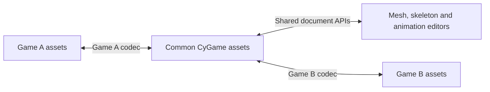

# Common asset format — portable contract 0.1 / schema v1

Status: working portable Python library/CLI and optional CyToolsCore handlers.
Native 0.22.0 integrates a bounded editable `.cy3d` profile, mesh/skeleton/animation
panels and GLB/CyPack import/export. Read [Native3DAssets](Native3DAssets.md) for
exact supported edits and limits. Conversion planners still are not game codecs.

## Architecture

A reusable editor should own neutral asset documents. Each game integration supplies
import/export codecs for its real formats and verifies its output with that game.
The common document is the place where future mesh/skeleton/animation editors work;
engine-specific codecs should not be embedded in the UI.



The first implemented serialized contract is `.cypack`: our versioned JSON envelope
and unchanged glTF 2.0 GLB data. glTF already defines geometry, skinning and animation
storage. Reuse that specification instead of inventing another binary vertex/clip
encoding. Our envelope adds asset identity, provenance and namespaced game metadata.
This is a source/interchange asset, not a game's optimized runtime representation.

Primary references:

- [glTF 2.0 specification](https://registry.khronos.org/glTF/specs/2.0/glTF-2.0.html).
- [Official Khronos validator](https://github.com/KhronosGroup/glTF-Validator).

## Portable and game-specific data

| Common layer | Game integration still supplies |
|---|---|
| Geometry, UVs, normals/tangents, indices as supported by glTF | Native mesh layouts, compression, streaming and runtime limits |
| Joint hierarchy, bind poses, skinning data | Engine bone IDs, limits, rig conventions and native serialization |
| Animation channels/times/interpolation | Native compression, events/controllers, root-motion rules and playback semantics |
| Embedded texture resources and common material data | Game texture codecs, shader graphs and material parameter mapping |
| Scene-node transforms and references within a GLB | Full game maps, gameplay entities, navigation, lighting and physics |

The transport preserves data; it does not decode/edit every feature listed above.
A game profile must report unsupported features and required extensions instead
of silently discarding them. Physics/collision, LOD policies, custom controllers and
other engine data may need namespaced metadata or future standardized extensions.
Do not assume another game understands opaque extension data.

## v1 container

Exactly two regular ZIP entries are allowed:

```text
manifest.json
asset.glb
```

`app/schemas/portable-asset.schema.json` is the envelope schema. A package describes
one self-contained 3D payload, which may contain several meshes, a rig and clips:

```json
{
  "format": "cygame-portable-asset",
  "schemaVersion": 1,
  "assetId": "ef7603e1-84f8-44b2-87da-a677412c462a",
  "name": "AnimatedTriangle",
  "kind": "scene3d",
  "space": {
    "handedness": "right", "upAxis": "+Y", "linearUnit": "meter",
    "rotation": "quaternion-xyzw", "timeUnit": "second"
  },
  "payload": {
    "path": "asset.glb", "mediaType": "model/gltf-binary",
    "bytes": "actual integer byte count", "sha256": "actual 64-character lowercase digest"
  },
  "summary": "actual inspected declaration summary",
  "extensions": {"org.example.game": {"opaqueSourceMetadata": {}}},
  "provenance": {"sourceGame": "Example", "sourceFormat": "native-format", "converterId": "example.import"}
}
```

The byte count, digest and summary placeholders above are explanatory, not a valid
fixture. See the actual manifests returned by inspecting the supplied examples.
Metadata namespaces use dotted lowercase names. No original absolute path is added
automatically; provenance accepts only sourceGame/sourceFormat/sourceSha256/converterId.
Unknown namespaced metadata and GLB bytes survive copying a package between SDK roots.

Generate an asset UUID once and preserve it through edits/transfers. `package_glb`
creates one by default; pass `asset_id` when preserving an existing identity.
The target SDK must detect an existing UUID with different data and request an
explicit update/duplicate policy. There is no global asset database, revision history,
automatic conflict resolver or per-bone UUID map in this prototype.

Coordinates follow glTF: right-handed, Y-up, linear distances in meters, TRS rotations
as XYZW quaternions and animation times in seconds. A game codec must transform the
actual mesh positions/normals/tangents, winding, bind matrices and animation tracks
when converting conventions. Changing the manifest's axis label is not conversion.

## Implemented API and CLI

`app/portable_assets` provides:

- `package_glb(source, destination, name=..., asset_id=..., extensions=..., provenance=...)`.
- `inspect_package(source)` and `read_package(source)` for metadata/integrity and raw GLB.
- `export_glb(source, destination)` for byte-preserving extraction, with a hash and loss report.
- `ConversionRegistry.register(descriptor)` and `plan_export(source, converter_id)`.

Run from the project root:

```powershell
.\runtime\python\Scripts\python.exe app\portable_asset_cli.py inspect app\examples\portable\AnimatedTriangle.cypack
.\runtime\python\Scripts\python.exe app\portable_asset_cli.py pack <SOURCE.glb> <NEW_OUTPUT.cypack> --name "My Asset"
.\runtime\python\Scripts\python.exe app\portable_asset_cli.py export-glb <SOURCE.cypack> <NEW_OUTPUT.glb>
.\runtime\python\Scripts\python.exe app\portable_asset_cli.py plan app\examples\portable\AnimatedTriangle.cypack --profile app\examples\portable\Example_StaticOnlyConverter.json
```

CLI destinations are explicit persistent user files. Existing files are never
overwritten. Publication uses a same-directory temporary file and an exclusive
hard link, requiring filesystem hard-link support. Exported GLB is byte-identical;
this is not retargeting or native game conversion. CLI stdout is structured UTF-8 JSON.
A successful plan command can still report `status: blocked`: inspect the plan fields.

The example static-only target blocks animation and skinning. Unsupported optional extensions report `review-required` with an explicit loss-review
flag; they are not silently ignored. A compatible declared
game profile reports `provider-required`, with `executionAvailable:false`, until
its real provider is implemented. The only executable export here is the GLB
identity path. `app/schemas/converter-profile.schema.json` defines profile metadata.
There are no asset-supplied commands, executable plugins or automatically loaded codecs.

## Optional SDK/MCP integration through CyToolsCore

`portable_assets.service.operation_descriptors()` supplies three descriptors:
`portable_pack`, `portable_inspect`, `portable_export_glb`. A derived SDK can append
them to its existing manifest generator, then call:

```python
from portable_assets.service import OPERATION_IDS, register_operations
# In the existing create_runtime factory, before the runtime starts:
# 1. Declare the descriptors in the manifest.
# 2. Exclude OPERATION_IDS from the generic native-proxy registration loop.
# 3. Register these handlers instead.
register_operations(runtime, dedicated_shared_asset_input_directory)
```

Do not register a duplicate handler or create another scheduler/MCP implementation.
The helper uses the official Core ProcessWorker and `app/portable_asset_worker.py`.
The configured shared input root must be disjoint from private runtime storage;
path traversal and output/report escapes are rejected. Inputs are shared project
assets for authorized clients; they are not private per-client source directories.
Outputs/reports are always allocated with `JobContext.path`. Core owns progress,
cancellation, processes, identities and task cleanup. Export results with Core's
`export_job` / `cy_export_job` before `finish_task` / `cy_finish_task` if needed.
A temporary task's unexported results are removed; CLI persistent destinations are
a different explicit file operation.

These handlers have been tested with the real Core SDK. They are not installed in
the native 0.20 catalogue under their standalone portable_* IDs. Native 0.20
uses the separate bounded model_* and asset_import operations. Before exposing them in a desktop build,
also bind native GUI requests to the existing SDK client/worker pattern and extend
its operation routing. A JSON declaration alone does not add a native GUI handler.
Add localized operation labels when exposing these actions in the GUI.
See [BuildProviders.md](BuildProviders.md) and [GameAdapterGuide.md](GameAdapterGuide.md).

## Validation scope and limits

Limits: 64 MiB GLB payload, 4 MiB GLB JSON, 128 KiB envelope, 80 MiB ZIP file,
64 JSON nesting levels, at most 100,000 entries in each inspected declaration array.
The profile allows JSON then an optional BIN chunk and one embedded buffer.
It rejects all `uri` properties, including data URIs and extension-specific URI
properties: resources must use embedded BIN bufferViews. It resolves no network
or external file dependencies. Extra/archive traversal entries, duplicate members,
symlinks, encryption and unsupported compression are rejected; no `extractall` is used.

Library checks cover the envelope, SHA-256/size/summary consistency, strict JSON,
GLB framing, embedded buffer bounds and inspected declaration shapes. They do not
validate every accessor, vertex, rig relationship, animation value, image or glTF
extension. Reports explicitly say `semanticValidation: not-performed`. Use a full
glTF validator and the target game's validator in production conversion providers.
A `ready` identity plan means a raw export is available, not that a game accepts it.

Two original fixtures are supplied: static triangle and two-joint skinned triangle
with a quaternion animation. Both were separately checked by the official Khronos
validator 2.0.0-dev.3.10 with zero errors/warnings. This evidence applies to those
fixtures, not automatically to every future input. The optional QA dependency is
local development tooling under runtime, Apache-2.0; it is not a new editor runtime
requirement or a redistributed copy of its implementation.

```powershell
.\runtime\python\Scripts\python.exe app\tests\test_portable_assets.py
npm.cmd install --prefix runtime\portable-validator --cache runtime\npm-cache --ignore-scripts --no-audit --no-fund --save-exact gltf-validator@2.0.0-dev.3.10
node app\tests\validate_portable_fixtures.cjs
```

Evidence: `data/reports/portable-assets-tests.log`, `portable-khronos-results.json`
and `portable-assets-validation.json`. No game fixture or binary is uploaded by these checks.

## Native implementation and following layers

1. Neutral native documents: MeshDocument (vertex streams/indices/submeshes),
   SkeletonDocument (stable bones/parents/bind transforms), AnimationDocument
   (tracks/time/curves), with validated edits, Undo and versioned serialization.
   Native 0.20 implements the bounded APIs in Scene3D/ModelCommands; the package
   remains the portable interchange contract.
2. Shared Static Mesh editor: real render buffers, orbit/picking, bounds, UV/normal/
   tangent inspection, material slots and explicit LOD/collision policies.
3. Skeleton and Animation editors: hierarchy, pose preview, skin weights, playback,
   timeline, keyframes, clips, root-motion inspection and bounded CPU/GPU evaluation.
4. Real game codecs: source -> neutral documents -> validated game output, with
   capability/limit checks and explicit conversion-loss reports through Core jobs.
5. Retargeting: bone mapping, reference-pose and axis/scale correction. A clip can
   transfer with its original rig; applying it to another rig requires this layer.

The native 0.21 implementation covers real triangle buffers, editable stream
properties, hierarchy/TRS, skinning, clips/tracks/keys and playback. The complete
production tools listed above remain broader than this bounded profile. Native 0.21
adds static LODs, primitive collisions and reference-pose retargeting; topology, IK,
engine physics cooking and game codecs remain work. Read AdvancedAuthoring.md.

The common layer can later cover texture source data, basic PBR materials and scene
placement. Gameplay, shader graphs, controllers, physics and full native maps remain
adapter contracts until their semantics are deliberately standardized and implemented.

## Native 0.21 authoring metadata

The portable component stays 0.1 / envelope schema v1. Native metadata uses the
`org.cygame.editor` namespace, with per-mesh LOD primitive buffers, collision shape
declarations and bounded processing history. Preserve unknown fields and UUIDs.
Bulk data is embedded in glTF root extras, not MSFT_lod or game physics extensions.
The CyPack manifest holds a storage/schemaVersion/sha256 reference to that extras
value: SHA-256 over sorted-key compact UTF-8 JSON. Decode verifies the reference;
legacy identical full namespace copies are accepted and conflicting copies rejected.
This avoids duplicating large LOD buffers in the 128 KiB envelope manifest.

Full model exports retain authoring metadata. Selected-LOD exports replace real
geometry and omit the other stored variants. Stale generated variants cannot be
selected/exported; collision review markers require explicit review for game export.
These declarations do not automatically enable engine LOD selection or collision
simulation. See GameCodecs.md for trusted provider and target-validation contracts.

## Native 0.22 animation and namespace transfer

See AnimationTools.md for bounded single-chain IK, sampled root-motion extraction/
reconstruction and trim/resample. These produce ordinary editable animation clips;
the rootMotion editor namespace records the extracted pair and float32 pose hashes.
No engine movement or physics semantics are implied. The portable 0.1 component
and v1 envelope schema remain unchanged.

Raw GLB now also carries non-editor portable namespaces in root
extras["org.cygame.metadata"]. The bulk editor namespace retains its existing
extras["org.cygame.editor"] slot and manifest payload reference. Unknown sibling
values survive both paths; conflicting envelope copies or absent referenced
payloads reject. Export replaces only these owned transport slots, preserving
other original glTF extras. These conventions require a supporting SDK.
